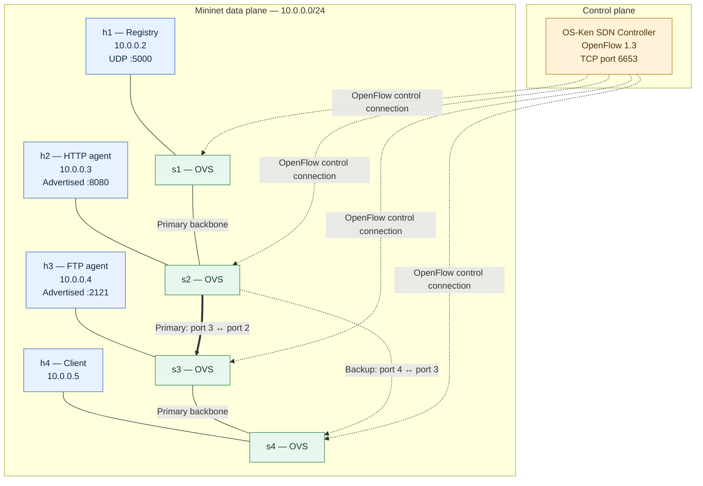

# UDP-Based Service Discovery System with SDN

A C-based UDP service registry integrated with a Software-Defined Networking (SDN) testbed. The project demonstrates service registration and discovery, heartbeat-based service failure detection, and SDN-controlled forwarding with a predefined backup path.

The main tested implementation is in `member2/` and uses **Mininet + Open vSwitch + OpenFlow 1.3 + OS-Ken**.

---

## Contents

- [1. Project overview](#1-project-overview)
- [2. Architecture and topology](#2-architecture-and-topology)
- [3. Host and service addressing](#3-host-and-service-addressing)
- [4. Requirements](#4-requirements)
- [5. Download the project](#5-download-the-project)
- [6. Compile the C programs](#6-compile-the-c-programs)
- [7. Start the system](#7-start-the-system)
- [8. Test service discovery](#8-test-service-discovery)
- [9. Test service failure detection](#9-test-service-failure-detection)
- [10. Test SDN link failure and backup routing](#10-test-sdn-link-failure-and-backup-routing)
- [11. Measure connectivity and latency](#11-measure-connectivity-and-latency)
- [12. Stop and clean up](#12-stop-and-clean-up)
- [13. UDP message protocol](#13-udp-message-protocol)
- [14. Project files](#14-project-files)
- [15. Implementation notes and limitations](#15-implementation-notes-and-limitations)

---

## 1. Project overview

The project combines two related functions:

1. **Service discovery and monitoring:** HTTP and FTP service agents register their service name, IP address and port with a central UDP registry. They periodically send heartbeat messages. Clients ask the registry for a service endpoint.
2. **SDN network management:** An OS-Ken controller programs OpenFlow 1.3 forwarding rules in Open vSwitch switches. If the primary inter-switch link between `s2` and `s3` fails, the controller installs higher-priority rules that use the alternative path through `s4`.

### Main features

- UDP service registration and discovery
- Central service registry on UDP port `5000`
- HTTP and FTP service advertisements
- Periodic service heartbeats (every 5 seconds)
- Registry heartbeat timeout (10 seconds)
- Service deregistration (implemented by the HTTP agent)
- Client responses containing the service IP and port, or `SERVICE_NOT_FOUND`
- Mininet topology with four hosts and four Open vSwitch switches
- OpenFlow 1.3 forwarding rules for IPv4 and ARP
- Port-status event handling by the SDN controller
- Predefined backup forwarding path after the primary link fails

---

## 2. Architecture and topology

### Logical architecture

- **Registry:** maintains the service table and answers client discovery requests.
- **HTTP agent:** advertises `HTTP` at `10.0.0.3:8080`.
- **FTP agent:** advertises `FTP` at `10.0.0.4:2121`.
- **Client:** requests a service by name and receives its advertised endpoint.
- **OS-Ken controller:** installs forwarding rules in the switches using OpenFlow 1.3.
- **OVS switches:** forward packets according to the rules installed by the controller.

### Mininet network topology

The diagram below shows the host roles, IP addresses, switch-to-switch links, and the normal and backup paths.



**Normal path:** `s1 → s2 → s3 → s4`

**Backup path when the `s2–s3` link fails:** `s2 → s4 → s3`

The controller detects the failure from the port-status event on switch `s2`, port `3`, and installs backup rules with a higher priority than the normal rules.

### Switch port map

Port numbers are assigned by the order in which links are added in `member2/sdn_topology.py`.

| Switch | Port | Connected device | Purpose |
|---|---:|---|---|
| s1 | 1 | h1 (Registry) | Host attachment |
| s1 | 2 | s2 | Backbone |
| s2 | 1 | h2 (HTTP) | Host attachment |
| s2 | 2 | s1 | Backbone |
| s2 | 3 | s3 | Primary link; failure trigger |
| s2 | 4 | s4 | Backup link |
| s3 | 1 | h3 (FTP) | Host attachment |
| s3 | 2 | s2 | Primary link |
| s3 | 3 | s4 | Backbone / backup-path continuation |
| s4 | 1 | h4 (Client) | Host attachment |
| s4 | 2 | s3 | Backup-path continuation |
| s4 | 3 | s2 | Backup link |

---

## 3. Host and service addressing

| Mininet host | Role | IP address | Port / protocol |
|---|---|---|---|
| h1 | Registry | `10.0.0.2` | UDP `5000` |
| h2 | HTTP service agent | `10.0.0.3` | Advertises TCP/application port `8080` |
| h3 | FTP service agent | `10.0.0.4` | Advertises TCP/application port `2121` |
| h4 | Client | `10.0.0.5` | Sends UDP discovery requests to registry |

The HTTP and FTP programs in this prototype advertise service endpoints to the registry. They are service-discovery agents; they do not implement full HTTP or FTP data-transfer servers.

---

## 4. Requirements

The tested environment used:

- Linux / WSL2 Ubuntu
- GCC
- Python 3
- Mininet
- Open vSwitch
- OS-Ken
- OpenFlow 1.3 support

Check the installed tools:

```bash
gcc --version
python3 --version
mn --version
ovs-vsctl --version
```

The OS-Ken environment used for the controller is a Python virtual environment at `~/osken-env`.

Activate it and check the package:

```bash
source ~/osken-env/bin/activate
pip show os-ken
```

If the virtual environment has not been created yet, create it and install OS-Ken:

```bash
python3 -m venv ~/osken-env
source ~/osken-env/bin/activate
python -m pip install --upgrade pip
pip install os-ken
```

Mininet and Open vSwitch installation depends on the Linux distribution. On Ubuntu, the usual package command is:

```bash
sudo apt update
sudo apt install build-essential mininet openvswitch-switch python3-venv
```

---

## 5. Download the project

Clone the repository and enter the project directory:

```bash
git clone https://github.com/aryanreddy7227-sudo/udp-service-discovery.git
cd udp-service-discovery
```

If the repository is already cloned, enter the existing directory instead:

```bash
cd ~/udp-service-discovery
```

---

## 6. Compile the C programs

Run these commands from the project root, `~/udp-service-discovery`:

```bash
gcc -Wall -Wextra registry.c -o registry
gcc -Wall -Wextra server.c -o server
gcc -Wall -Wextra ftp_server.c -o ftp_server
gcc -Wall -Wextra client.c -o client
```

The four executables should now be present:

```bash
ls -lh registry server ftp_server client
```

If you change any C source file, compile that program again before running it.

---

## 7. Start the system

Start the controller and Mininet before launching the service programs. Use separate terminal windows for the following processes.

### Terminal 1 — Start the OS-Ken SDN controller

```bash
cd ~/udp-service-discovery/member2
source ~/osken-env/bin/activate
python run_sdn_controller.py
```

Leave this terminal running. The controller listens for OpenFlow switch connections on TCP port `6653`.

### Terminal 2 — Start the Mininet topology

Open a second terminal:

```bash
cd ~/udp-service-discovery/member2
CTRL_IP=$(hostname -I | awk '{print $1}')
echo "Controller IP: $CTRL_IP"
sudo mn --custom sdn_topology.py --topo sdnservice --controller=remote,ip=$CTRL_IP,port=6653 --switch ovsk,protocols=OpenFlow13
```

Keep the Mininet CLI open. Wait for all four switches to connect and for the controller to print their configuration messages.

> If the controller and Mininet are running in different environments, use the controller machine's reachable IP address instead of the automatically detected WSL IP.

### Terminal 3 — Start the registry inside h1

Open another terminal:

```bash
cd ~/udp-service-discovery
sudo mnexec -a $(pgrep -f "mininet:h1") $HOME/udp-service-discovery/registry
```

Expected startup messages:

```text
[REGISTRY] UDP socket created.
[REGISTRY] Listening on UDP port 5000...
```

### Terminal 4 — Start the HTTP service agent inside h2

```bash
cd ~/udp-service-discovery
sudo mnexec -a $(pgrep -f "mininet:h2") $HOME/udp-service-discovery/server
```

The agent registers `HTTP` at `10.0.0.3:8080`, receives the registry acknowledgement, and sends heartbeats every 5 seconds.

### Terminal 5 — Start the FTP service agent inside h3

```bash
cd ~/udp-service-discovery
sudo mnexec -a $(pgrep -f "mininet:h3") $HOME/udp-service-discovery/ftp_server
```

The agent registers `FTP` at `10.0.0.4:2121`, receives the registry acknowledgement, and sends heartbeats every 5 seconds.

### Terminal 6 — Client commands from h4

Discover HTTP:

```bash
sudo mnexec -a $(pgrep -f "mininet:h4") $HOME/udp-service-discovery/client HTTP
```

Discover FTP:

```bash
sudo mnexec -a $(pgrep -f "mininet:h4") $HOME/udp-service-discovery/client FTP
```

A successful response has this format:

```text
SERVICE|HTTP|10.0.0.3|8080
SERVICE|FTP|10.0.0.4|2121
```

---

## 8. Test service discovery

First, confirm basic connectivity from the Mininet CLI:

```text
pingall
```

Expected result when all links are up:

```text
0% dropped (12/12 received)
```

Then run the client commands from Terminal 6:

```bash
sudo mnexec -a $(pgrep -f "mininet:h4") $HOME/udp-service-discovery/client HTTP
sudo mnexec -a $(pgrep -f "mininet:h4") $HOME/udp-service-discovery/client FTP
```

The registry should respond with the matching service name, IP address and port.

---

## 9. Test service failure detection

This test demonstrates **service failure**, not a network-link failure.

1. Stop the FTP agent by pressing `Ctrl+C` in Terminal 5.
2. Wait for more than the registry's 10-second heartbeat timeout.
3. The registry should print a timeout message for FTP.
4. Run the FTP discovery command again:

```bash
sudo mnexec -a $(pgrep -f "mininet:h4") $HOME/udp-service-discovery/client FTP
```

Expected client response:

```text
[CLIENT] Received: SERVICE_NOT_FOUND
```

The FTP agent stops sending heartbeats when it exits. The registry marks FTP inactive after the timeout, so later discovery requests return `SERVICE_NOT_FOUND`.

Restart the FTP agent using the Terminal 5 command in [Section 7](#7-start-the-system). The agent will register again.

---

## 10. Test SDN link failure and backup routing

This test demonstrates **network-link failure**. Keep the registry and service agents running.

In the Mininet CLI, bring down the primary link:

```text
link s2 s3 down
```

The controller should report that switch `s2`, port `3`, has changed state and should install the backup forwarding rules.

The backup path is:

```text
s2 → s4 → s3
```

Check connectivity again in the Mininet CLI:

```text
pingall
```

The previously tested result was:

```text
0% dropped (12/12 received)
```

This indicates that the hosts remain mutually reachable using the backup path.

Bring the physical link back up:

```text
link s2 s3 up
```

The controller logs the port-status event. **The current controller does not remove the higher-priority backup flow entries automatically.** To return to a clean initial forwarding state, stop Mininet and restart the controller and topology as described in [Section 12](#12-stop-and-clean-up).

---

## 11. Measure connectivity and latency

Use the Mininet CLI to measure traffic between h2 and h3 over the s2–s3 connection.

With the primary link up:

```text
h2 ping -c 10 h3
```

For a backup-path measurement:

```text
link s2 s3 down
h2 ping -c 10 h3
```

Record packet loss and the reported minimum, average and maximum round-trip times. Repeat measurements several times under the same conditions for a fair comparison.

Mininet timings are affected by host scheduling, ARP resolution and system load. Do not conclude that one path is inherently faster from a single short test.

---

## 12. Stop and clean up

1. Stop the HTTP and FTP agents with `Ctrl+C` in their terminals.
2. Stop the registry with `Ctrl+C`.
3. Exit the Mininet CLI:

```text
exit
```

4. Stop the OS-Ken controller with `Ctrl+C`.
5. Clean up Mininet and OVS state:

```bash
sudo mn -c
```

If Mininet reports stale state on the next run, run `sudo mn -c` again before launching a new topology.

---

## 13. UDP message protocol

The registry listens on UDP port `5000`.

| Message | Sender | Meaning |
|---|---|---|
| `REGISTER|HTTP|10.0.0.3|8080` | HTTP agent | Register HTTP service endpoint |
| `REGISTER|FTP|10.0.0.4|2121` | FTP agent | Register FTP service endpoint |
| `REGISTRY_ACK` | Registry | Acknowledge registration |
| `HEARTBEAT|HTTP|10.0.0.3` | HTTP agent | Refresh HTTP liveness timestamp |
| `HEARTBEAT|FTP|10.0.0.4` | FTP agent | Refresh FTP liveness timestamp |
| `DISCOVER|HTTP` | Client | Request HTTP endpoint |
| `DISCOVER|FTP` | Client | Request FTP endpoint |
| `SERVICE|HTTP|10.0.0.3|8080` | Registry | Return HTTP endpoint |
| `SERVICE|FTP|10.0.0.4|2121` | Registry | Return FTP endpoint |
| `SERVICE_NOT_FOUND` | Registry | Requested service is not active |
| `DEREGISTER|HTTP` | HTTP agent | Mark HTTP service inactive on graceful shutdown |

### Timing parameters

| Parameter | Value |
|---|---:|
| Heartbeat interval | 5 seconds |
| Registry timeout | 10 seconds |
| Registry UDP port | 5000 |
| Maximum registry entries | 100 |

---

## 14. Project files

| File | Description |
|---|---|
| `common.h` | Shared UDP port and buffer definitions |
| `registry.c` | UDP registry, service table, heartbeat timeout and discovery handling |
| `server.c` | HTTP service registration, heartbeat and deregistration agent |
| `ftp_server.c` | FTP service registration and heartbeat agent |
| `client.c` | Command-line client for HTTP or FTP discovery |
| `member2/sdn_topology.py` | Four-host, four-switch Mininet topology |
| `member2/sdn_controller.py` | OpenFlow 1.3 controller with IPv4/ARP forwarding and backup routes |
| `member2/run_sdn_controller.py` | Starts the OS-Ken controller application |
| `controller.py`, `controller_backup.py`, `topology.py`, `topology_star_backup.py` | Additional controller and topology experiments |
| `member2/topology_controller.py`, `member2/run_topology_controller.py` | Separate topology-aware controller experiment |

The main end-to-end instructions in this README use `member2/sdn_topology.py`, `member2/sdn_controller.py`, and `member2/run_sdn_controller.py`.

---

## 15. Implementation notes and limitations

- The registry is centralized; if it stops, clients cannot discover services through it.
- The registry uses a fixed 10-second heartbeat timeout. This is a prototype setting, not a universally optimal timeout.
- The SDN controller uses a predefined backup route. It does not calculate the least-congested route dynamically.
- The current backup flow entries have higher priority and are not automatically removed when the primary link comes back up. Restarting the controller and Mininet topology restores a clean initial state.
- The HTTP and FTP programs advertise service endpoints; they do not provide full HTTP or FTP data-transfer functionality.
- The testbed is a small Mininet emulation and is not a production network deployment.

## Authors

PES University — UDP-Based Service Discovery System with SDN
